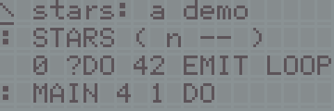
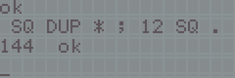
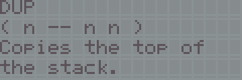

# 4Forth: a Forth system for the VTech Genio 2000 (Z80 at about 6.13 MHz)

A 32 KiB cartridge (two 16 KiB pages, autostart `55 AA 59 45`) that turns the Genio into an interactive
Forth machine: type Forth at a command line, or write a program in a full-screen editor and LOAD or RUN
it. Its kernel is a port of [Firth](https://github.com/jhlagado/firth) (John Hardy, GPL-3.0); the
console, keyboard, editor, guide and OFF handling are those of [EASM](https://github.com/kresp0/easm)
and [EBASIC](https://github.com/kresp0/ebasic), which in turn follow the
[text editor](https://github.com/kresp0/vtech-genio2000/tree/main/examples/text-editor).

| Editor | RUN | Command line | Guide (AYUDA) |
|---|---|---|---|
|  |  |  |  |

*(MAME snapshots, 4x enlarged.)*

* **159 words**: stack, 16-bit arithmetic with 32-bit `UM* UM/MOD M* SM/REM */`, comparisons, memory,
  `: ; CREATE DOES> VARIABLE CONSTANT IMMEDIATE POSTPONE RECURSE`, `IF ELSE THEN BEGIN UNTIL AGAIN
  WHILE REPEAT DO ?DO LOOP +LOOP I J LEAVE UNLOOP`, strings (`." S" ABORT" .( ( \`), pictured numbers
  (`<# # #S HOLD SIGN #>`), `KEY KEY? ACCEPT`, `WORDS DUMP FORGET EMPTY`, and the Genio's own:
  `PAGE AT-XY BEEP TONE LED GLYPH MS`.
* **A command line**: each line runs on INTRO and ends in ` ok`, as in any Forth. ALT+Ü brings the last
  line back.
* **An editor** for the program (2720 bytes of text): `LOAD` forgets the user's words and reads the whole
  text; `RUN` does the same and then runs the last word of the text. An error during LOAD shows the
  line; the QUE SOY key goes there in the editor.
* **A guide** on the AYUDA key (the second cartridge page): 20 topics and one page for every word, with
  its stack effect and an example that INTRO types into the command line or the editor. AYUDA on a word
  opens its page.
* **The activity panel** types common words (`: ; DUP DROP SWAP OVER ROT IF ELSE THEN DO LOOP I BEGIN
  UNTIL @ ! . ." CR EMIT KEY VARIABLE CONSTANT .S (`) and has the editor's commands (LOAD, RUN, WORDS,
  LINE, LOCATE, page up/down, last error, line numbers, insert/delete line).
* **RESPUESTA** stops a running word (also an endless loop that never reads the keyboard), and **OFF**
  switches the unit off at any time, also inside such a loop.

On-screen text is in English; key names are the Spanish legends printed on the keys.

**Machines.** Written for the Spanish VTech Genio 2000, and tested in MAME so far. It will most likely also work on its
relatives the Genius 4000, Genius LEADER 4000 Quadro, Genius LEADER 4004 Quadro L and PreComputer
Power Pad, but it has not been tried on them; their keyboards carry other legends, so the key names
used here and some typed characters may differ.

## A first session
```
: SQ DUP * ;  ok
12 SQ . 144  ok
: STARS 0 ?DO 42 EMIT LOOP ;  ok
5 STARS *****  ok
440 500 TONE  ok
```
In the editor (RESPUESTA):
```
\ stars: a demo
: STARS ( n -- )
  0 ?DO 42 EMIT LOOP ;
: MAIN 4 1 DO
  I STARS CR LOOP ;
```
then the BASIC key of the panel (RUN): `*`, `**`, `***`, `ok`.

## Keys
| Name used here | Key | |
|---|---|---|
| INTRO | INTRO | run the line; in the editor, split the line (the new one keeps the indentation) |
| RESPUESTA | RESPUESTA | command line <-> editor; leaves the guide; **stops a running word** ("Break") |
| AYUDA | AYUDA | the guide (on a word: its page); SHIFT+AYUDA is TAB |
| BORRAR | REPETIR / BORRAR | delete to the left; at the start of an editor line, join it to the line above |
| DEL | JUGADOR DERECHA / DEL | delete to the right; at the end of an editor line, join the next one |
| RETROCESO, AVANCE | RETROCESO, AVANCE | cursor; with ALT, start and end of the line |
| ALT+Ü, ALT+; | | line up / down (at the command line ALT+Ü recalls the last line) |
| OFF | OFF | switches off (the text and the words are lost: the RAM is not kept) |

SHIFT and ALT give the signs of the legends (`! " # $ % & / ( ) = ? : ; < >` with SHIFT, `\ @ - _ + [ ] = | ~`
with ALT on the digits); caps lock is on at start-up. Column by column, the panel is:

| Column | Keys (top to bottom) |
|---|---|
| 1 | `: ` `; ` `DUP ` `DROP ` `SWAP ` |
| 2 | `OVER ` `ROT ` `IF ` `ELSE ` `THEN ` |
| 3 | `DO ` `LOOP ` `I ` `BEGIN ` `UNTIL ` |
| 4 | `@ ` `! ` `. ` `." ` `CR ` |
| 5 | `EMIT ` `KEY ` `VARIABLE ` `CONSTANT ` `.S ` |
| 6 | `( `; CINE Y TELEVISION page up; HISTORIA Y GEOGRAFIA page down; GENERAL `LINE `; QUE SOY the line of the last error |
| 7 | EL NUMERO RELAMPAGO `LOAD`; BASIC `RUN`; IMPRIMIR TEXTO the command line; CALCULADORA `WORDS`; CARTUCHOS ADICIONALES `LOCATE ` |
| 8 | NIVEL line numbers on/off; 1 JUGADOR inserts an empty line; 2 JUGADORES deletes the line |

`KEY` returns ASCII and code page 850 characters, INTRO 13, BORRAR 8, DEL 127, RETROCESO 136, AVANCE 137,
ALT+; 138, ALT+Ü 139, AYUDA 142, TAB 9, and the panel keys 192-213 and 240-255 in panel order
(RESPUESTA is not a key for programs: it stops them).

## The language
4Forth follows Forth-2012 for the words it has, with these choices:
* Cells are 16 bits. Names have up to 31 characters and any case (stored in upper case).
* `/ MOD /MOD */ */MOD` are symmetric (rounded towards 0), as `SM/REM`. A division by 0, or a quotient
  that does not fit, is the error "Division error".
* Numbers: `$FF` hex, `#10` decimal, `%101` binary, `'A'` a character, `-` after the prefix (`$-10`).
* `." S" .( (` and `\` work while interpreting too; `S"` then gives the text in place in the line.
* `LOAD` = `EMPTY` + read the editor's text, and it ends the command line it is on. `RUN` = `LOAD` +
  run the last word defined. `EDIT`, `LINE n`, `LOCATE text` go to the editor; `NEW` erases the text
  (after INTRO); `BYE` returns to the Genio's menu.
* `EMIT` treats 13 and 10 as a new line, 8 as backspace, 7 as a beep, 12 as clear; any other code goes
  into the cell as it is, so `n EMIT` shows user glyph n for 0-6 (15 for glyph 7). `addr n GLYPH` loads
  glyph n from 8 bytes; glyphs 0-3 hold the accented capitals Á Í Ó Ú until they are redefined.
* `hz ms TONE` plays a square wave of 20-9999 Hz (0 is a rest) with interrupts off; `MS` waits with them
  on. `flag LED` sets the caps-lock LED.
* Errors (an unknown word shows `NAME ?`) empty the data stack, stop compiling and drop a definition
  that was not finished, as `ABORT` does.
* Missing: floating point, double-cell words other than the four above, `EVALUATE`, files and blocks,
  `SEE`, the search-order and locals word sets, port I/O (on purpose: see the rules below).

## Memory
| Range | Size | Use |
|---|---|---|
| C000-C0FF | 256 | the line being edited (editor, command line, `ACCEPT`) |
| C100-C1B3 | 180 | variables (`src/shared.inc`): shadow screen, cursor, keyboard, editor, Forth, guide |
| C200-C2FF | 256 | the line being interpreted; a page of the guide |
| C300-C37F | 128 | RAM code: the page trampolines and the interrupt hook |
| C380-C3F7 | 120 | the console saved under the editor; the guide's line table |
| C400-C47D | 126 | data stack (62 cells; the top is kept in BC) |
| C47E-C55F | 226 | return stack (SP; a word may only be entered while SP >= C4A0) |
| C560-CFFF | 2720 | the editor's text |
| D000-DA5F | 2656 | the dictionary of the user's words; then the number buffer and PAD (HERE+64) |
| DB00-DFFF | | the firmware's: its interrupt routine's variables and the hook at DFF5 |

Page 1 (port 0x03 = 0x80) holds everything but the guide: 10227 of 16384 bytes. Page 2 (0x83) holds the
guide: 11448 bytes. `make` prints these figures (`out/usage.txt`).

## How it works
* **The kernel** (`src/forth.s`) keeps Firth's machine model: the top of the data stack in BC, the rest
  of the data stack through IX (growing up), the return stack on the Z80 stack with the instruction
  pointer on top of it, and IY holding the address of `NEXT`, so a code word ends in `jp (iy)`.
  Threading is direct: a primitive is machine code, a colon word starts with `CALL docol`. NEXT costs
  63 T-states (about 97 000 primitives per second). Headers are Firth's `[link][flags+length][name]`; the
  ROM dictionary ends at `ROMLAST` and the user's words follow in RAM from D000.
* **Kept from Firth**: the register model, the threading through the return stack, the header layout,
  the flag bits (immediate, hidden), the structure of the interpreter (parse a name, find it, run or
  compile it, else convert a number), and the word names. **Changed**: Firth enters colon words with
  `RST 08`, but the Genio's `RST` vectors are in its firmware ROM, so 4Forth uses `CALL`; Firth's
  source is unfinished (its loop and comparison words mix three conventions for the instruction
  pointer, `R@` reads the data stack, `UM/MOD` and several words are eForth fragments that are never
  linked), so every word was rewritten and tested rather than translated. The outer interpreter and
  the compiling words are in assembly; `DO` loops keep the index offset by the limit, so that `LOOP`
  and `+LOOP` end on the Z80's overflow flag.
* **Safety in loops**: every backward branch (`AGAIN UNTIL REPEAT LOOP +LOOP`) checks the data stack
  pointer, and `docol` the return stack pointer, so `BEGIN 1 AGAIN` and endless recursion stop with
  "Stack full" / "Return stack full" instead of overwriting the rest of the RAM. Underflow is checked
  after every word the interpreter runs.
* **The interrupt hook** (`src/main.s`): 4Forth runs the firmware's 46.76 Hz interrupt routine as a timer
  and cursor service, as EASM and EBASIC do (DB00 = D0, DB01 != B4, the hook at DFF5). While Forth runs,
  the hook reads the keyboard column of RESPUESTA and OFF on every interrupt: RESPUESTA abandons the
  word ("Break"), and OFF held for two interrupts switches the unit off with the firmware's own
  sequence. At the prompt and in the editor, OFF is polled with the keyboard (EASM's routine).
* **The command line** copies each line to C200 before interpreting it, so that a program can call
  `ACCEPT` (which edits in C000) during the line.
* **The guide** (`help.txt` -> `tools/gen_help.py` -> page 2) reads the word list from the headers of
  `src/forth.s`, fails the build if a word has no page or a header's length is wrong, compresses the
  text with a 128-piece dictionary and checks that every page fits the viewer.

## Build
```bash
make            # -> 4forth_gl2000_AT28C256_32K.bin and 4forth_gl2000_mame_64K.bin
make test       # the MAME tests (below)
```
Needs `sdasz80` and `sdldz80` (SDCC 4.5) and `python3`; VGLDK is not used (the cartridge is pure
assembly, like EASM). `tools/check_tone.py` reads the assembler listing and fails the build unless
`TONE`'s loop takes exactly 26 T-states per turn plus 86 per half period, which is what the conversion
from Hz assumes.

| File | |
|---|---|
| `4forth_gl2000_AT28C256_32K.bin` | the image for an AT28C256: page 1, then page 2. It is not a mirrored 16 KiB image: the guide needs the second half |
| `4forth_gl2000_mame_64K.bin` | the same twice, for MAME's `-cart` (MAME decodes selector bit 0, the RevD board bit 1) |
| `4forth_tone_mame.wav` | `TONE` recorded in MAME (`tests/t05_sound.txt`): 440, 1000, 262, 330, 392, 523 Hz |
| `out/` | listings, maps, `4forth.sym`, `usage.txt`, `words.txt` |
| `SHA256SUMS` | of both images |

## Tests (MAME, headless)
`tests/run_tests.sh` (or `make test`) runs MAME's `genio` build (from `~/PROYECTOS/genio2000/mame-upstream`, or
`MAME=...`, with your own ROM dump in its `roms_local`) with `-video none`, presses keys on the emulated matrix
(`tests/drive.lua`, EASM's driver with additions) and checks the shadow screen, memory, the HD44780's
CGRAM and the CPU's PC:

| Test | Covers |
|---|---|
| `t00_smoke` | start-up screen, arithmetic, `:`, division signs, `.S`, underflow, unknown word, `DO LOOP`, `+LOOP` down, number prefixes |
| `t01_load` | LOAD and RUN of a text with `DOES>`, `RECURSE`, `LEAVE`, `J`, `S"`, `WHILE`; compile-only words; an error at line 2 shown and reached with QUE SOY |
| `t02_errors` | stack and return stack overflow inside loops, division, dictionary full, unbalanced `IF`, `FORGET` of a ROM word, `ABORT"`, RESPUESTA breaking `BEGIN AGAIN`, OFF switching off inside a loop |
| `t03_editor` | typing, joining and deleting lines, the RUN and LOAD panel keys, the error line, panel text keys, AYUDA on a word, an example taken and run, ALT+Ü recall, `ACCEPT`, `KEY`, `WORDS` paging and break, the guide's index |
| `t04_words` | 100 checks of the arithmetic, stack, memory, comparison, control and defining words against their expected values (`tests/words1.fs`, `words2.fs`), and the number printing words |
| `t05_sound` | `TONE` recorded with `-wavwrite`; `tests/check_wav.py` measures every note within 1 % |
| `t06_genio` | `GLYPH` in the HD44780's CGRAM (and the accents in slot 0 kept), `EMIT` of a glyph, `AT-XY`, `LED` (port 0x12 bit 5), `MS` timing, OFF at the prompt |
| examples | every one of the guide's 151 runnable examples typed at the command line: no error message |

Every test also watches each `OUT` of the cartridge: only ports 0x03 (with 0x80), 0x0A, 0x0B, 0x10 and
0x12 are written, and bit 0 of 0x12 only in the power-off sequence. Result on 2026-11-12: all passed.

## Status
**Verified in MAME only; not yet run on a real Genio.** What that means:
* MAME zeroes the RAM at power-on; the unit does not. 4Forth clears its variables, stacks and text at
  start-up and does not depend on the rest, but this has not been checked on the unit.
* The mame-upstream `genio` build fires the interrupt at 50 Hz, not the 46.76 Hz measured on the unit:
  OFF inside a running word must be held for two interrupts (21-43 ms on the unit, 20-40 ms in MAME).
  `MS` and `TONE` are busy loops counted in T-states, so their timing does not depend on it; `MS` is
  about 1 % longer than asked because the interrupt routine steals cycles (`TONE` disables it).
* The pitch of `TONE` follows the CPU clock: 6.13179 MHz in MAME, about 6.13 MHz measured on the unit.
* The interrupt hook (RESPUESTA and OFF while a word runs) is EASM's mechanism extended with OFF; EASM's
  break with RESPUESTA has itself been tested only in MAME. If the firmware's routine behaved differently
  on the unit, RESPUESTA would not stop an endless loop and OFF would only work when the program reads
  the keyboard; switching off with the batteries or the cartridge would then be the only way out.
* LCD timing: about 70 us between writes (no busy flag read), as in EASM and EBASIC, which have run on
  the unit.
* No undocumented Z80 opcodes are used. No `HALT` except in the firmware's power-off sequence (in the OFF
  routine and in the hook). Port 0x12 is always written with bit 0 clear, except there. No port I/O
  words are offered to programs, so a Forth program cannot write the power-off bit or the bank
  selectors; it can still write any RAM with `!`, `C!`, `FILL` and `MOVE`, including the firmware's
  (DB00-DFFF) and 4Forth's own variables, which can hang the unit.
* The text and the words are lost at power-off: there is no storage.

## Licence
* GPL-3.0-or-later (`LICENSE`), Copyright (C) 2026 Santiago Crespo: 4Forth's own files and the parts
  taken from EASM and EBASIC (same author and licence).
* `src/forth.s` is derived from Firth, Copyright (C) John Hardy, released under the GPL version 3
  (`third_party/firth/`); that file is therefore GPL-3.0-only for Firth's part, and the cartridge as a
  whole is distributed under the GPL version 3.
